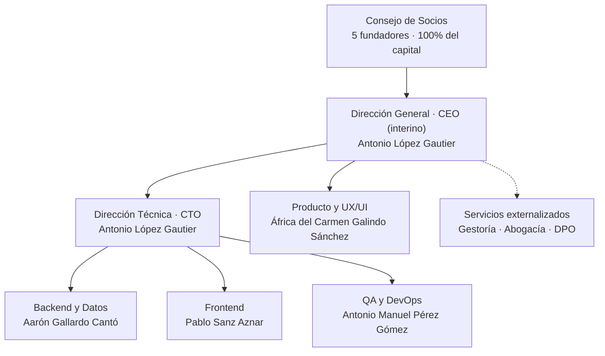
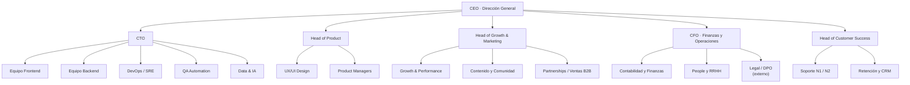

# Estructura organizativa de Apañao

## Introducción

Este documento define cómo se organizaría **Apañao** si el proyecto dejase de ser un trabajo de clase y pasase a operar como una empresa real. No describe el organigrama de una gran corporación: describe la estructura mínima que permite **construir el producto, captar usuarios, cumplir con la ley y no quemar al equipo**, y cómo esa estructura crece cuando el producto crece.

La estructura se ha diseñado a partir de la información ya recogida en el repositorio:

- El equipo real y sus roles declarados en [`README.md`](../README.md).
- El funcionamiento interno acordado en el contrato de equipo de la fase académica (sprints, revisión cruzada de PR y comunicación por Discord).
- El alcance del MVP y el stack MERN descritos en el análisis de viabilidad técnica del proyecto.
- Los riesgos técnicos identificados en ese mismo análisis (LLM para recetas, APIs de supermercados, *free tier*).
- El análisis de mercado recogido en [`docs/analisis-competencia.md`](analisis-competencia.md).

> **Nota:** la asignación nominal de roles de la Fase 0 es una **propuesta revisable por el Consejo de Socios**. El documento fija las funciones, no las personas: si mañana alguien cambia de área, el organigrama sigue siendo válido.

---

## 1. Resumen ejecutivo

| Pregunta | Respuesta |
| :--- | :--- |
| **¿Qué tipo de empresa sería?** | Startup tecnológica **B2C** de consumo, *mobile-first*, con modelo **freemium** y producto desplegado como SaaS sobre stack MERN. |
| **¿Forma jurídica?** | **Sociedad Limitada (S.L.)** de nueva creación, acogida al régimen de *startup* de la Ley 28/2022. |
| **¿Estructura inicial?** | **Equipo fundador de 5 personas** con roles duales. Cero contrataciones durante la validación. |
| **¿Cuándo se contrata?** | A partir de la Fase 1 (tracción), cuando haya métricas de retención y la primera vía de ingresos validada. |
| **¿Cómo escala?** | De 5 → 9-12 (tracción) → 20-30 (crecimiento) → 40-60 (escala), con especialización progresiva por departamentos y luego por *squads*. |

**Idea central:** con cinco personas no se puede tener un departamento por función; se tienen **responsables de área con doble sombrero**. El organigrama no se inventa para parecer grande, se **activa por fases** según lo que el negocio necesita en cada momento.

---

## 2. Tipo de empresa y modelo de negocio

### 2.1. Clasificación

**Startup tecnológica de consumo (B2C product-led)**, no una consultora ni un SaaS B2B. Las razones:

| Característica | Apañao | Consecuencia organizativa |
| :--- | :--- | :--- |
| **Cliente final** | Estudiante / joven recién independizado | El área de Growth y Soporte pesa tanto como Ingeniería |
| **Producto** | Aplicación web/móvil con datos personales y de salud | Legal/DPO es estructural, no un gasto puntual |
| **Precio** | Bajo (freemium) y alto volumen | No hay equipo comercial clásico al inicio; se crece por producto y comunidad |
| **Coste marginal** | Inferencia de IA + APIs de supermercados | Hace falta alguien que vigile el coste por usuario y por receta |
| **Velocidad** | MVP en meses, no años | Equipos pequeños, decisiones rápidas, documentación ligera |

### 2.2. Líneas de ingreso previstas

1. **Freemium:** núcleo gratuito (despensa, menús básicos, lista de la compra) y plan **Premium** (~2,99 €/mes) con planificación avanzada, alertas de caducidad, táperes ilimitados y modo piso compartido.
2. **Afiliación / *retail media*:** comisión por enlace o integración con supermercados (Mercadona, Carrefour, DIA, Lidl). Depende de la viabilidad de las APIs ya señalada como riesgo en la documentación técnica.
3. **B2B2C:** licencias para residencias de estudiantes, universidades y ayuntamientos (programas de alimentación saludable y reducción del desperdicio).
4. **Futuro:** datos agregados y anonimizados sobre hábitos de consumo (siempre con base legal y consentimiento explícito).

### 2.3. Forma jurídica y gobernanza

- **S.L.** con los cinco fundadores como socios, reparto inicial a acordar (recomendado evitar el 20/20/20/20/20 plano y ponderar por dedicación y aportación).
- **Pacto de socios** con *vesting* a 4 años y cláusula de * cliff* de 12 meses, derecho de adquisición preferente y protocolo de salida.
- **Consejo de Socios** como órgano máximo: una persona, un voto en las decisiones ordinarias; mayoría de 3/5 para las extraordinarias (ver §11.2).
- **Certificación como startup** (Ley 28/2022) para acceder a tipo reducido de Impuesto de Sociedades y facilidades de atracción de talento.

---

## 3. Principios organizativos

1. **Un responsable por área, aunque tenga dos sombreros.** En Fase 0 cada área tiene un dueño claro para evitar la parálisis por consenso.
2. **Especialización tardía.** No se crea un departamento hasta que el volumen de trabajo justifica una persona dedicada. Antes, se externaliza o se reparte.
3. **Product-led, no sales-led.** El crecimiento viene del producto y de la comunidad; el equipo comercial aparece cuando existe una vía B2B que vender.
4. **Documentación como infraestructura.** Todo lo que no está en `/docs` no existe. Es la única forma de que cinco personas con disponibilidad limitada no se pisen.
5. **Revisión cruzada obligatoria.** Ya recogida en el contrato de equipo: ningún cambio llega a `main` sin PR revisado por otra persona.
6. **Coste cero como restricción de diseño, no como excusa.** El *free tier* (Vercel + Render + Atlas) define la arquitectura y obliga a tener criterio de infraestructura desde el día uno.
7. **Nadie es imprescindible en una sola cabeza.** Cada área tiene un *backup* documentado (ver §11.1).

---

## 4. Fase 0: el equipo fundador

**Tamaño: 5 personas. Contrataciones: 0.** Los cinco socios cubren las funciones críticas con roles duales.

| Persona | Rol técnico (README) | Rol organizativo propuesto | Responsabilidad principal |
| :--- | :--- | :--- | :--- |
| **Antonio López Gautier** | Backend Lead | **CEO interino + CTO** | Estrategia, arquitectura, API y modelo de negocio técnico |
| **África del Carmen Galindo Sánchez** | Frontend Lead | **Head of Product & UX/UI** | Roadmap, experiencia de usuario, diseño de interfaz y liderazgo del frontend |
| **Aarón Gallardo Cantó** | DataBase Manager | **Backend & Data Engineer** | Modelo de datos, MongoDB, integridad, APIs de supermercados |
| **Pablo Sanz Aznar** | Frontend | **Frontend Developer + Growth/Community** | Implementación de interfaz, contenido, redes y captación |
| **Antonio Manuel Pérez Gómez** | QA y despliegue | **QA & DevOps / Release Manager** | Testing, CI/CD, despliegues, observabilidad y control de releases |

### 4.1. Por qué esta distribución

- **Respeta lo que el equipo ya sabe hacer.** La asignación parte de los roles declarados en el README y de la tabla de habilidades del análisis de viabilidad técnica, no de un organigrama ideal.
- **Concentra la autoridad técnica y la de negocio en la misma persona solo de forma temporal.** Antonio como CEO+CTO es una solución de Fase 0: garantiza coherencia entre lo que se promete y lo que se puede construir. En Fase 1 los roles se separan.
- **África absorbe Producto y Frontend.** Es la persona con más contexto sobre la experiencia de usuario, pero es también la sobrecarga más evidente del equipo: **la primera contratación debe aliviarla**.
- **Pablo cubre la parte que nadie más puede cubrir.** Sin Growth no hay usuarios; sin usuarios no hay producto que validar. Su doble rol Frontend + Community es la única forma de no dejar vacío el área comercial en Fase 0.
- **A. Manuel concentra calidad y despliegue.** DevOps y QA son la misma disciplina en un equipo de este tamaño: quien despliega es quien mejor sabe qué puede romperse.

### 4.2. Servicios externalizados desde el día uno

| Servicio | Proveedor | Por qué se externaliza |
| :--- | :--- | :--- |
| **Gestoría fiscal y laboral** | Gestoría local | Obligaciones contables, modelos trimestrales, nóminas |
| **Asesoría legal** | Abogado mercantil | Constitución de la S.L., pacto de socios, condiciones de uso |
| **DPO / Protección de Datos** | DPO externo | Datos de salud (alérgenos) y RGPD: no se puede improvisar |
| **Contabilidad analítica** | Herramienta SaaS | Coste real por usuario y por inferencia de IA |

---

## 5. Organigrama de la Fase 0

**Lectura del diagrama:**

- El **Consejo de Socios** manda; el CEO ejecuta y rinde cuentas ante él.
- La línea **CEO → CTO** es la única jerarquía técnica formal de esta fase.
- **Producto** cuelga de Dirección, no de Tecnología: el roadmap no lo decide quien programa, lo decide quien entiende al usuario.
- Las líneas discontinuas representan **relación contractual, no jerarquía**.

---

## 6. Departamentos y funciones

La siguiente descripción es la **estructura objetivo**. En Fase 0 cada departamento está cubierto por una o varias personas del equipo fundador; en fases posteriores se desdobla en equipos.

### 6.1. Dirección / Gerencia

**Misión:** decidir qué se construye, qué se descarta y con qué recursos.

| Función | Entregable |
| :--- | :--- |
| Definir la visión y la estrategia anual | Plan estratégico y OKR trimestrales |
| Priorizar el roadmap junto con Producto | Roadmap publicado en el tablero |
| Aprobar presupuesto e inversión en infraestructura | Presupuesto trimestral |
| Representar a la empresa ante inversores y socios | *Deck* y memoria anual |
| Resolver bloqueos entre áreas | Decisión registrada en `/docs` |

**KPI:** *runway* (meses de caja), crecimiento mensual de usuarios activos, cumplimiento de OKR.

---

### 6.2. Departamento de Producto y Diseño

**Misión:** convertir problemas reales de estudiantes en funcionalidades que se usan.

| Rol | Funciones |
| :--- | :--- |
| **Product Manager / Head of Product** | Priorizar el *backlog*, escribir *user stories*, validar hipótesis, decidir qué entra y qué no en cada release |
| **UX/UI Designer** | *Wireframes*, prototipos, sistema de diseño, pruebas de usabilidad |
| **UX Research** (a partir de Fase 2) | Entrevistas con usuarios, análisis de fricción, validación de casos de uso |

**Procesos propios:** descubrimiento continuo (5 entrevistas al mes mínimo), *design review* antes de implementar, y una **regla dura**: ninguna funcionalidad entra en el roadmap si no resuelve uno de los casos de uso recogidos en el análisis del problema.

**KPI:** *North Star* = **menús planificados por usuario activo y semana**; retención D30; ratio de recetas guardadas o cocinadas.

---

### 6.3. Departamento de Desarrollo (Ingeniería)

**Misión:** construir y mantener el producto de forma segura, rápida y sostenible.

#### CTO (Chief Technology Officer)
- Define la arquitectura y el stack (MERN: MongoDB, Express, React, Node.js).
- Toma las decisiones técnicas irreversibles (base de datos, autenticación, proveedor de IA).
- Vela por la seguridad, la deuda técnica y el coste de infraestructura.
- Responsable final de las decisiones del apartado de viabilidad técnica.

#### Frontend Developers
- Implementan la interfaz en React con React Router, Zustand, TanStack Query, Tailwind y Lucide.
- Garantizan experiencia *mobile-first*, accesibilidad y rendimiento.
- Mantienen el sistema de diseño junto con UX/UI.

#### Backend Developers
- Construyen la API REST `/api/v1` en Express.
- Implementan autenticación JWT, hash con bcrypt, validación con Zod y seguridad con Helmet y *rate limiting*.
- Desarrollan la lógica de negocio: despensa, menús, sincronización de la lista de la compra.

#### DevOps / SRE Engineers
- Gestionan Vercel (frontend), Render (backend) y MongoDB Atlas.
- Mantienen CI/CD, entornos, secretos y *rollback*.
- Vigilan latencia, disponibilidad y el comportamiento del *free tier* (arranque en frío de Render).
- Definen la política de copias de seguridad y recuperación.

#### QA Engineers
- Diseñan el plan de pruebas y los casos críticos (registro, despensa, sincronización de compra).
- Automatizan pruebas de regresión en el pipeline.
- Verifican criterios de aceptación antes de cada release y mantienen el registro de bugs.

#### Data & Integraciones (a partir de Fase 1)
- Mantienen el catálogo base de recetas y la capa híbrida IA + catálogo descrita en el Riesgo 4.
- Integran las APIs de supermercados y normalizan precios y productos.
- Controlan el coste por inferencia y la calidad de las respuestas del modelo.

**KPI:** *lead time* de cambio, frecuencia de despliegue, tasa de fallo en producción, cobertura de pruebas críticas, coste mensual de infraestructura e IA.

---

### 6.4. Departamento de Marketing y Ventas (Growth)

**Misión:** que los estudiantes que tienen el problema descubran que Apañao existe.

| Rol | Funciones |
| :--- | :--- |
| **Head of Growth / Marketing Manager** | Estrategia de captación, canales, presupuesto de adquisición, experimentos |
| **Community Manager** | Gestión de redes (TikTok, Instagram, Discord), contenido cercano, gestión de la comunidad |
| **Content / SEO** | Recetas, guías de ahorro, contenido indexable y ASO en tiendas de apps |
| **Partnerships / Ventas B2B** (Fase 2) | Acuerdos con supermercados, universidades y residencias |

**Particularidad del sector:** el público objetivo no responde a publicidad corporativa. La estrategia se basa en **contenido útil** (recetas de 2 €, retos de compra semanal) y en **crecimiento orgánico** dentro de comunidades universitarias.

**KPI:** CAC, instalaciones orgánicas, ratio de conversión a Premium, seguidores y *engagement* por canal.

---

### 6.5. Departamento de Atención al Cliente (Customer Success)

**Misión:** que el usuario que empieza a usar Apañao siga usándolo.

| Función | Detalle |
| :--- | :--- |
| Soporte N1 | Dudas de uso, incidencias de cuenta, problemas con la lista de la compra |
| Soporte N2 | Escalado de bugs a Ingeniería con reproducción documentada |
| *Onboarding* | Guía de primeros pasos: alta de despensa y primer menú |
| Retención | Detección de usuarios inactivos, encuestas de cancelación, *win-back* |
| Feedback estructurado | Traslado de peticiones recurrentes a Producto con evidencia |

**KPI:** tiempo de primera respuesta, *tickets* por 100 usuarios activos, CSAT, retención D30 y churn de Premium.

---

### 6.6. Departamento de Administración y Finanzas

**Misión:** que la empresa no se quede sin caja ni tenga sorpresas fiscales.

| Función | Detalle |
| :--- | :--- |
| **CFO / Dirección Financiera** | Presupuesto, *runway*, modelo financiero, relación con inversores |
| Facturación y cobros | Suscripciones Premium, comisiones de afiliación, facturación B2B |
| Control de costes | Coste de infraestructura, IA y APIs frente a ingreso por usuario |
| Compras y proveedores | Contratos con Vercel, Render, Atlas, proveedor de IA |
| Reporting | Cuenta de resultados mensual y *dashboard* de métricas |

En Fase 0 esta función la asume el CEO con apoyo de gestoría externa.

---

### 6.7. Legal y Compliance / DPO

**Misión:** que crecer no implique una sanción.

| Ámbito | Actuaciones |
| :--- | :--- |
| **RGPD y LOPDGDD** | Registro de actividades de tratamiento, base legal, consentimiento explícito |
| **Datos de salud** | Alérgenos e intolerancias son categoría especial (art. 9 RGPD): consentimiento explícito, minimización y cifrado obligatorios |
| **Derechos del usuario** | Acceso, rectificación, supresión y portabilidad: procedimiento y plazo de un mes |
| **Condiciones de uso y privacidad** | Política de privacidad, cookies (LSSI) y términos del servicio |
| **Consumidores** | Información de precios, suscripciones y derecho de desistimiento |
| **IA** | Transparencia sobre el uso de modelos generativos y revisión de sesgos en recomendaciones |
| **Tiendas de apps** | Cumplimiento de políticas de Apple App Store y Google Play |

**Regla interna:** ninguna funcionalidad que trate datos de salud sale a producción sin la revisión del DPO, aunque sea externo.

---

### 6.8. Personas / RRHH

**Misión:** atraer y retener al equipo adecuado sin construir una burocracia innecesaria.

- En Fase 0-1: externalizado (gestoría laboral + CEO).
- En Fase 2: **People Manager** dedicado a contratación, *onboarding*, evaluación y clima.
- Prácticas: banda salarial transparente, revisión semestral, políticas de desconexión y de trabajo en remoto.

---

## 7. Matriz RACI de decisiones críticas

**R** = Responsable de ejecutar · **A** = Aprueba · **C** = Consultado · **I** = Informado.

| Decisión | CEO | CTO | Head of Product | CFO / Ops | Legal / DPO |
| :--- | :---: | :---: | :---: | :---: | :---: |
| Visión y OKR trimestrales | **A/R** | C | C | C | I |
| Priorización del roadmap | A | C | **R** | C | I |
| Arquitectura y elección de stack | I | **A/R** | C | I | I |
| Release a producción | I | **A** | C | I | C |
| Gasto en infraestructura e IA | A | C | I | **R** | I |
| Nueva funcionalidad con datos de salud | A | C | C | I | **R** |
| Contratación y salario | **A** | C | C | R | I |
| Acuerdo con un supermercado | **A/R** | C | C | C | C |
| Constitución, pacto de socios y ampliación de capital | **A/R** | I | I | C | C |

---

## 8. Escalado por fases

### 8.1. Tabla de crecimiento

| Fase | Horizonte | Personas | Foco del negocio | Altas previstas |
| :--- | :--- | :---: | :--- | :--- |
| **0 · Validación y MVP** | 0-6 meses | **5** | MVP funcional, primeras 1.000 descargas, validar los casos de uso | Ninguna (fundadores) |
| **1 · Tracción** | 6-18 meses | **9-12** | Retención D30, primera vía de ingresos, reducción del coste por usuario | 1 Frontend, 1 Backend, 1 QA Automation, 1 Growth, 1 Soporte (media jornada) |
| **2 · Crecimiento** | 18-36 meses | **20-30** | Monetización, partnerships, expansión nacional | Heads de área, Data & IA, SRE, Ventas B2B, People |
| **3 · Escala** | 36+ meses | **40-60** | Multi-mercado (Portugal, LATAM), rentabilidad | *Squads* completos, Data Science, BizDev, Soporte 24/5 |

### 8.2. Disparadores de contratación

No se contrata por sensación, se contrata cuando se cumple un disparador:

| Contratación | Disparador objetivo |
| :--- | :--- |
| **Frontend #2** | África dedica más del 50 % de su tiempo a producto y el *backlog* de interfaz crece dos sprints seguidos |
| **QA Automation** | Más de 3 regresiones por release o más de 40 h/mes de pruebas manuales |
| **Backend #2** | La API supera las 50 h/mes de mantenimiento o aparecen incidencias fuera de horario |
| **Growth** | CAC por debajo de 3 € y presupuesto de adquisición validado |
| **Soporte** | Más de 30 *tickets*/semana o tiempo de respuesta superior a 24 h |
| **Data & IA** | Coste de inferencia superior al 15 % del ingreso por usuario |
| **Ventas B2B** | Al menos dos acuerdos piloto con residencias o universidades firmados |

### 8.3. Evolución de la estructura

1. **Fase 0 — Roles duales.** Cinco personas, cinco áreas cubiertas, tres servicios externalizados.
2. **Fase 1 — Primer desdoblamiento.** Se liberan los cuellos de botella (Frontend y QA) y aparece Growth como función real. Sigue habiendo un solo nivel de dirección.
3. **Fase 2 — Departamentos con *head*.** Se separan CEO y CTO, se crea Producto como área propia y aparecen los primeros mandos intermedios.
4. **Fase 3 — *Squads* por dominio.** Cada *squad* (Despensa, Planificación, Monetización) agrupa Producto + Diseño + Ingeniería + QA y responde a un objetivo de negocio, no a una disciplina técnica.

---

## 9. Organigrama de la Fase 2

**Cambios clave respecto a la Fase 0:**

- **CEO y CTO se separan.** Es la señal de que la empresa ya no depende de una sola cabeza para decidir y para construir.
- **Producto deja de colgar de Dirección** y se convierte en área con *head* propio.
- **Legal y DPO siguen externalizados**, pero con contrato de servicio y reporte directo a Finanzas/Ops: es más barato y más especializado que internalizarlo antes de los 50 empleados.

---

## 10. Ritos y procesos de trabajo

La estructura sin procesos es un dibujo. Estos son los ritos que sostienen el organigrama, coherentes con los acuerdos de funcionamiento del equipo:

| Rito | Frecuencia | Participantes | Salida |
| :--- | :--- | :--- | :--- |
| *Daily* asíncrono en Discord | Diario | Todo el equipo | Bloqueos detectados en menos de 2 h |
| Planificación de sprint | Semanal | Todo el equipo | Tablero actualizado con asignación única |
| Revisión de producto | Semanal | Producto + Ingeniería | Demo de lo construido y decisiones de alcance |
| *Design review* | Por funcionalidad | Producto, UX/UI, Frontend | Prototipo aprobado antes de programar |
| Revisión de PR | Por cambio | Autor + revisor obligatorio | Ningún merge sin aprobación |
| *Release* | Quincenal | QA + DevOps + CTO | Versión desplegada y verificada |
| Retrospectiva | Quincenal | Todo el equipo | Una acción de mejora con dueño |
| Revisión de OKR | Trimestral | Consejo de Socios + *heads* | Objetivos del siguiente trimestre |
| *Post-mortem* de incidencia | Tras cada incidente grave | Equipo implicado | Causa raíz y medida correctiva documentada |

**Regla de oro heredada del contrato:** si alguien se bloquea, lo comunica en menos de 2 horas. La estructura organizativa no sirve de nada si el bloqueo se queda en silencio.

---

## 11. Riesgos organizativos y mitigación

### 11.1. Riesgo: *bus factor* de 1

**Riesgo:** con cinco personas, si una desaparece, un área entera se para. Aarón concentra el modelo de datos; A. Manuel, el despliegue.

**Mitigación:**
- Cada área tiene un **backup documentado** (quién puede cubrir a quién).
- Documentación obligatoria de decisiones en `/docs`.
- Rotación puntual en revisiones de PR para que todo el mundo toque todo el código al menos una vez.
- Emparejamiento (*pair programming*) en las partes críticas: autenticación, sincronización de la compra y modelo de datos.

### 11.2. Riesgo: bloqueo en la toma de decisiones

**Riesgo:** cinco socios con el mismo peso pueden empatar indefinidamente.

**Mitigación:** el pacto de socios fija mayoría de **3/5** para decisiones extraordinarias y **CEO con voto de calidad** en las ordinarias. Toda decisión se registra con fecha, contexto y responsable.

### 11.3. Riesgo: datos de salud tratados sin garantías

**Riesgo:** alérgenos e intolerancias son categoría especial del art. 9 RGPD. Un fallo aquí no es un bug, es una sanción.

**Mitigación:** DPO externo desde la Fase 0, consentimiento explícito separado, minimización de datos, cifrado en tránsito y en reposo, y revisión legal obligatoria antes de cualquier funcionalidad nueva que use estos datos.

### 11.4. Riesgo: dependencia de APIs de terceros

**Riesgo:** ya identificado en la viabilidad técnica. Si Mercadona o Carrefour cambian sus condiciones, la lista de la compra deja de funcionar.

**Mitigación:** capa de abstracción propia sobre las APIs, catálogo de precios de respaldo, y un responsable claro de integraciones (Backend & Data en Fase 0, Data & IA en Fase 2).

### 11.5. Riesgo: coste de la IA descontrolado

**Riesgo:** depender de un LLM en cada consulta dispara la latencia y el coste por usuario.

**Mitigación:** modelo híbrido catálogo + IA (Riesgo 4 de la viabilidad técnica), con límites de uso por plan, caché de sugerencias frecuentes y alerta cuando el coste por usuario supera el umbral definido.

### 11.6. Riesgo: equipo sin perfil comercial

**Riesgo:** cinco perfiles técnicos y ningún especialista en negocio. El producto puede ser bueno y no venderse.

**Mitigación:** Growth entra en la primera contratación de Fase 1; el CEO dedica tiempo explícito a negocio (no solo a código); se busca un mentor o asesor con experiencia en consumo B2C.

### 11.7. Riesgo: *burnout* por roles duales

**Riesgo:** mantener dos sombreros durante demasiado tiempo desgasta y baja la calidad.

**Mitigación:** revisión trimestral de carga por persona, límite de horas semanales acordado, y compromiso de que **ningún rol dual se mantiene más de 12 meses** sin revisión.

---

## 12. Anexos

### 12.1. Glosario de roles

| Término | Significado |
| :--- | :--- |
| **CEO** | *Chief Executive Officer*: dirección general y estrategia |
| **CTO** | *Chief Technology Officer*: dirección técnica y arquitectura |
| **CPO** | *Chief Product Officer* o *Head of Product*: dirección de producto |
| **CFO** | *Chief Financial Officer*: finanzas y operaciones |
| **DPO** | *Data Protection Officer*: delegado de protección de datos |
| **SRE** | *Site Reliability Engineer*: fiabilidad e infraestructura |
| **Squad** | Equipo pequeño y autónomo orientado a un objetivo de negocio |
| **Dual-hat** | Una persona cubre dos roles simultáneamente |
| **Bus factor** | Número de personas que pueden desaparecer sin paralizar el proyecto |

### 12.2. Referencias internas

**En esta rama:**

- [`README.md`](../README.md) — equipo, stack y enlaces del proyecto.
- [`docs/analisis-competencia.md`](analisis-competencia.md) — análisis de las soluciones existentes en el mercado.
- [`docs/estructura-organizativa.md`](estructura-organizativa.md) — este documento.

**Documentos de la fase académica** (disponibles en la rama `main`, reemplazados por la estructura final de `docs/`):

- `docs/CONTRATO.md` — compromisos, comunicación y calidad acordados por el equipo.
- `docs/propuesta/01-problema.md` — problema, usuarios, casos de uso y propuesta de valor.
- `docs/propuesta/02-viabilidad-tecnica.md` — MVP, arquitectura MERN, riesgos y capacidades del equipo.

**Pendiente en esta rama:** `docs/financiacion.md`, `docs/legislacion.md`, `docs/presupuesto.md` y `docs/recursos.md`.

### 12.3. Nota sobre los documentos de la fase académica

El `CONTRATO.md` (fase académica, rama `main`) menciona en su apartado de decisiones y conflictos la comunicación "entre los 4", mientras que el equipo actual está formado por **5 personas** (Pablo Sanz Aznar se incorporó después de la redacción inicial) y la tabla de habilidades de la viabilidad técnica recoge únicamente a 4 integrantes. Si esos documentos vuelven a la rama principal, conviene **actualizarlos a 5 miembros** para que la gobernanza descrita aquí sea coherente con la realidad del equipo.

---

> **Conclusión:** Apañao no necesita un organigrama grande, necesita un organigrama **honesto**. Cinco personas con responsabilidades claras, tres servicios externalizados y una regla de crecimiento basada en disparadores medibles permiten llevar el MVP a producción sin quemar al equipo. La estructura descrita aquí no es un adorno para la memoria del proyecto: es el mapa de quién decide qué, y ese mapa es exactamente lo que diferencia un proyecto de clase de una empresa.
