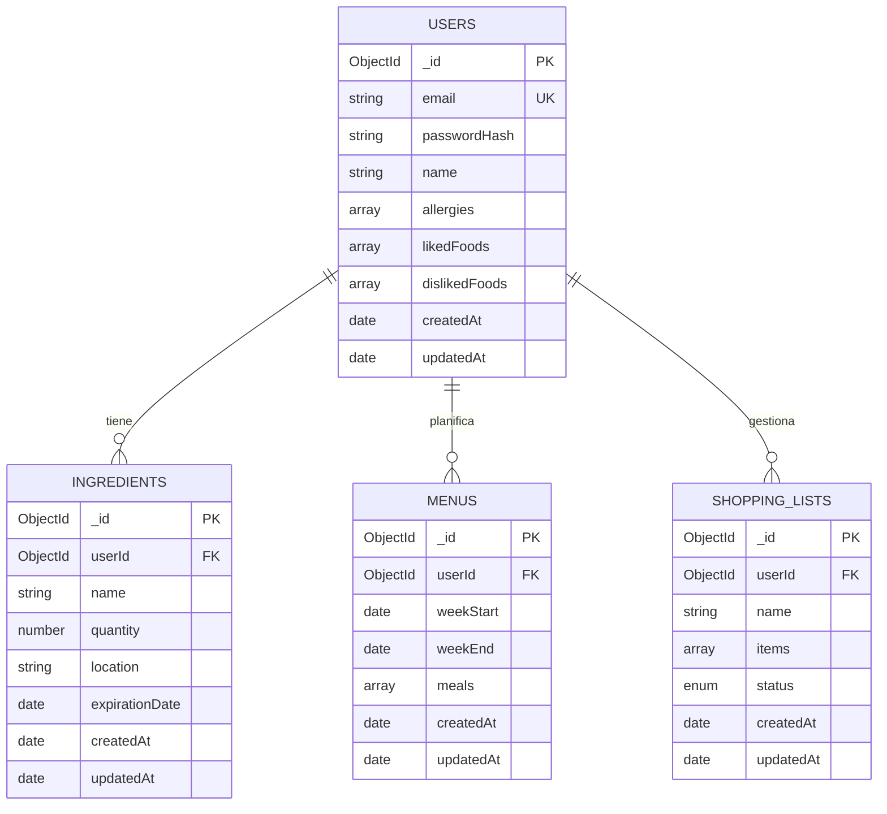

# Viabilidad técnica Apañao

## Introducción
El proyecto **Apañao** nace con la misión de aliviar la carga mental y económica de estudiantes y jóvenes recién independizados al gestionar su alimentación diaria, optimizar la despensa y planificar sus compras sin gastar de más. Para garantizar que esta solución sea técnicamente realista dentro del tiempo que disponemos y de los recursos disponibles, este documento presenta el análisis de viabilidad técnica de la aplicación. 

A lo largo de este documento se evalúan los requisitos funcionales priorizados bajo la metodología MoSCoW, la definición del Producto Mínimo Viable (MVP), la arquitectura del stack MERN (MongoDB, Express, React y Node.js) y los posibles riesgos que podemos encontrarnos durante el desarrollo y sus las posibles soluciones a estas.
 
 ## FUNCIONALIDADES PRINCIPALES

**Entre 10 y 20 funcionalidades principales de Apañao:**

1. **Gestión de Autenticación:**  
     El usuario puede registrarse e iniciar sesión en la aplicación

2. **Alta de Ingredientes:**  
     El usuario puede añadir un nuevo ingrediente al inventario de la despensa

3. **Actualización de Alimentos:**
     El usuario puede actualizar la cantidad o la fecha de caducidad de un producto en la despensa o la nevera

4. **Baja de Productos:**  
     El usuario puede eliminar un producto agotado o caducado del inventario

5. **Consulta de la despensa:**  
     El usuario puede consultar la lista completa de alimentos disponibles en su despensa

6. **Planificación de menús:**  
     El usuario puede generar menús semanales personalizados (seguramente con implementación de alguna API)

7. **Sugerencia de recetas:**  
     El usuario puede generar una propuesta de receta basada en los ingredientes disponibles en la despensa.

8. **Gestión de favoritos:**  
     El usuario puede marcar una receta como favorita para consultarla rápidamente

9. **Sincronización con la compra:**  
     El usuario puede añadir automáticamente los ingredientes faltantes de una receta a su lista de la compra

10. **Consulta la lista de la compra:**  
      El usuario puede consultar y editar los productos de su lista de la compra pendiente

11. **Traspaso a Despensa:**  
      El usuario puede marcar los productos de la lista de la compra como comprados para pasarlos directamente a la despensa virtual

12. **Alertas de caducidad:**  
      El usuario puede configurar alertas o avisos de productos próximos a caducar

13. **Configuración del perfil:**  
      El usuario puede configurar su perfil a su gusto, para recibir un trato más personalizado

14. **Gestión de alérgenos:**  
      El usuario puede seleccionar los alimentos a los que es alérgico y añadir sus intolerancias, como pueden ser el gluten o la lactosa

15. **Registro de tuppers:**  
      El usuario puede registrar un nuevo tupper cocinado especificando el plato, las raciones disponibles y la fecha de elaboración

16. **Alertas de descongelación:**  
      El usuario recibirá notificaciónes de descongelar el tupper los días que la app haya decidido que ese día se come tupper.

17. **Consulta de tuppers:**  
      El usuario puede consultar su stock de tuppers guardados en el congelador o la nevera con sus respectiva fecha de consumo preferente

18. **Menús semanales:**  
      El usuario podrá generar semanalmente un horario de comidas de todos los días en base a la comida que haya en la despensa, la nevera o los tuppers disponibles.

19. **Descuento de tupper:**  
      El usuario puede descontar una ración del tupper al incluirlo en la planificación de comida semanal.

20. **Gestión de favoritos:**  
      El usuario puede marcar una receta como favoritapara tenerla siempre accesible rápidamente.

# MVP de Apañao

### MUST HAVE

*Funcionalidades obligatorias para que la aplicación cumpla su propósito principal.*

Las funcionalidades esenciales de **Apañao** permiten gestionar los alimentos disponibles, conocer qué se puede cocinar y controlar las necesidades de compra.

- **Registro de usuarios:** Crear una cuenta en la aplicación mediante correo electrónico y contraseña.
- **Inicio de sesión:** Acceder al espacio personal mediante las credenciales del usuario.
- - **Cierre de sesión:** Cerrar la sesión de forma segura para proteger la información personal.
- **Configuración del perfil:** Consultar y modificar los datos personales y las preferencias de configuración.
- **Gestión de preferencias alimentarias:** Configurar ingredientes favoritos, ingredientes que no gustan, tipos de comida preferidos y tiempo disponible para cocinar.
- **Gestión de alérgenos e intolerancias:** Seleccionar los alérgenos e intolerancias del usuario para evitar recomendaciones de recetas que contengan esos ingredientes.
- **Gestión del presupuesto:** Establecer un presupuesto semanal máximo para adaptar las recomendaciones y las necesidades de compra al dinero disponible.
- **Alta de ingredientes:** Añadir alimentos a la despensa indicando su nombre y cantidad disponible.
- **Consulta de despensa:** Visualizar los alimentos registrados y disponibles en la nevera y la despensa.
- - **Actualización de alimentos:** Modificar las cantidades y los datos de los productos existentes en la despensa.
- **Gestión de táperes:** Registrar, consultar y gestionar los táperes disponibles, indicando su contenido, número de raciones, fecha de preparación y ubicación (nevera o congelador).
- **Actualización de táperes:** Modificar la información de los táperes registrados, incluyendo su contenido, número de raciones y ubicación.
- **Descuento de raciones:** Descontar las raciones disponibles de un táper cuando se consume o se utiliza para una comida.
- **Sugerencia de comidas:** Obtener propuestas de platos basadas en los ingredientes disponibles, los táperes existentes, las preferencias alimentarias, los alérgenos y el tiempo disponible.
- **Notificaciones de descongelación de táperes:** Enviar avisos automáticos la noche anterior cuando las recomendaciones de Apañao incluyan para el día siguiente un táper almacenado en el congelador, recordando al usuario que debe pasarlo a la nevera para que esté listo a la hora de comer.
- **Generación de la lista de la compra:** Crear una lista con los ingredientes que faltan para completar las recetas recomendadas.
- **Consulta y edición de la lista de la compra:** Visualizar, añadir, modificar y eliminar productos pendientes de compra.

### SHOULD HAVE

*Funcionalidades que aportan un valor considerable y completan la experiencia principal, pero que no son imprescindibles para una primera versión funcional.*

- **Baja de productos:** Eliminar alimentos agotados, caducados o que ya no se encuentren disponibles.
- **Organización de la compra:** Clasificar los productos de la lista de la compra por categorías o pasillos del supermercado (carne, huevos, lácteos, panadería, despensa, fruta y verdura).
- **Traspaso a despensa:** Marcar los productos comprados para incorporarlos directamente al inventario de la despensa.
- **Optimización de ingredientes:** Priorizar recetas que permitan aprovechar los mismos ingredientes durante varios días y reducir el desperdicio alimentario.

### COULD HAVE

*Funcionalidades complementarias que mejoran la comodidad y la experiencia de usuario, pero que pueden incorporarse si el calendario de desarrollo lo permite.*

- **Registro mediante fotografía:** Fotografiar el contenido de la nevera o los táperes para identificar y registrar automáticamente los alimentos.
- **Gestión de favoritos:** Guardar recetas favoritas para acceder a ellas rápidamente.
- **Alertas de caducidad:** Mostrar avisos visuales sobre los alimentos próximos a caducar.
- **Selección de supermercado:** Configurar el supermercado habitual para consultar precios estimados de los productos de la lista de la compra.
- **Estimación del coste de compra:** Calcular el coste aproximado de los ingredientes pendientes para comprobar si se ajustan al presupuesto semanal.
- **Ajuste por nivel de pereza:** Adaptar las recomendaciones según las ganas que tenga el usuario de cocinar ese día.

### WON'T HAVE

*Características avanzadas que quedan fuera del alcance de la primera versión del proyecto.*

- **Compartir inventario o menús en red:** Sincronizar en tiempo real la despensa, los táperes y las listas de la compra entre varios usuarios, como compañeros de piso o familiares.
- **Integración con supermercados:** Realizar pedidos y compras directamente desde la aplicación.
- **Reconocimiento avanzado de alimentos:** Identificar automáticamente todos los ingredientes y sus cantidades mediante inteligencia artificial sin necesidad de confirmación del usuario.
## DEFINICIÓN DEL MVP

En este apartado definimos el prodcuto mínimo viable de nuestra aplicación ***Apañao***:


* **Entrada y configuración inicial:**  
  El usuario abre la aplicación, realiza el Registro de Usuario, inicia sesión y configura rápido su perfil, añadiendo sus intolerancias, sus alergias y los alimentos que le gustan y los que no

* **Inventario básico:**  
  Añade los pocos ingredientes que tengas ahora mismo en la nevera y revisa lo que hay disponible

* **Cierre del ciclo:**  
La aplicación detecta automáticamente qué alimentos faltan para los menús y te genera una lista de la compra 


**1. Gestión de usuarios**  
ID	Requisito funcional

RF-01	El sistema permitirá registrar nuevos usuarios mediante correo electrónico y contraseña.  
RF-02	El sistema permitirá iniciar sesión mediante las credenciales del usuario.  
RF-03	El sistema permitirá consultar y modificar los datos personales y las preferencias del perfil.  

**2. Preferencias y restricciones alimentarias**  
ID	Requisito funcional  

RF-04	El sistema permitirá configurar los ingredientes favoritos del usuario.  
RF-05	El sistema permitirá indicar los ingredientes que el usuario no desea consumir.  
RF-06	El sistema permitirá seleccionar los tipos de comida preferidos.  
RF-07	El sistema permitirá configurar el tiempo disponible para cocinar.  
RF-08	El sistema permitirá seleccionar los alérgenos e intolerancias alimentarias del usuario.  
RF-09	El sistema permitirá establecer un presupuesto semanal máximo.  

**3. Gestión de la despensa**  
ID	Requisito funcional  

RF-10	El sistema permitirá añadir nuevos ingredientes a la despensa indicando su nombre y cantidad.  
RF-11	El sistema permitirá consultar todos los alimentos registrados en la despensa.  

**4. Gestión de táperes**  
ID	Requisito funcional  

RF-12	El sistema permitirá registrar nuevos táperes indicando su contenido, número de raciones, fecha de preparación y ubicación.  
RF-13	El sistema permitirá consultar los táperes disponibles en la nevera y el congelador.  
RF-14	El sistema permitirá modificar la información de los táperes registrados.  
RF-15	El sistema permitirá descontar las raciones disponibles de un táper cuando se consuma o se utilice para una comida.  

**5. Recomendación de comidas**  
ID	Requisito funcional  

RF-16	El sistema permitirá generar sugerencias de comidas utilizando los ingredientes disponibles en la despensa y los táperes registrados.  
RF-17	El sistema adaptará las recomendaciones a las preferencias alimentarias, los alérgenos, las intolerancias y el tiempo disponible del usuario.  
RF-18	El sistema tendrá en cuenta el presupuesto semanal configurado para adaptar las recomendaciones.  

**6. Notificaciones de táperes**  
ID	Requisito funcional  

RF-19	El sistema comprobará si las comidas recomendadas para el día siguiente incluyen táperes almacenados en el congelador.  
RF-20	El sistema enviará una notificación la noche anterior para recordar al usuario que debe trasladar el táper del congelador a la nevera.  

**7. Gestión de la lista de la compra**  
ID	Requisito funcional  

RF-21	El sistema permitirá generar automáticamente una lista de la compra con los ingredientes que falten para completar las recetas recomendadas.  
RF-22	El sistema permitirá consultar la lista de la compra pendiente.  
RF-23	El sistema permitirá añadir nuevos productos a la lista de la compra.  
RF-24	El sistema permitirá modificar los productos de la lista de la compra.  
RF-25	El sistema permitirá eliminar productos de la lista de la compra.  

## ANÁLISIS DE REQUISITOS TÉCNICOS

### 1. Frontend (React)

Para garantizar una experiencia rápida, reactiva y fluida en dispositivos móviles, utilizaremos (en la medida de lo posible y si es completamente necesario) las siguientes bibliotecas dentro del entorno **React** (vía Vite o Create React App):

| Biblioteca | Función / Ámbitos | Justificación y Por Qué la Necesitamos |
| ----- | ----- | ----- |
| **React Router (v6+)** | Navegación y Enrutamiento | Gestión de rutas dinámicas (pantallas de despensa, planificador, lista de la compra, recetas y tique). Permite la navegación fluida sin recargar la página (*Single Page Application*). |
| **Zustand** (o **Context API**) | Gestión de Estado Global | Manejo simplificado y ligero del estado del cliente (despensa temporal, filtros de recetas y carrito de la compra activo) antes o entre sincronizaciones con la API de Node.js. |
| **Axios** | Cliente HTTP | Gestión de peticiones hacia nuestro backend en Node.js/Express (obtención de recetas, actualización de inventario, registro/login). Facilita interceptores para el envío de tokens (JWT) y manejo centralizado de errores. |
| **TanStack Query (React Query)** | Gestión de Peticiones y Caché | Optimiza las peticiones a la API Express, evitando llamadas repetitivas al servidor, gestionando la caché de recetas/productos y refrescando los datos automáticamente cuando el usuario interactúa. |
| **Tailwind CSS + Lucide React** | Estilos e Iconos | Diseño *mobile-first* ágil, adaptado a interfaces simples para jóvenes, e integración de iconografía ligera y clara para la gestión de Nevera, Táper, Monedas y Presupuesto. |

---

### 2. Backend (Node.js + Express)

Para gestionar la lógica de negocio de **Apañao**, utilizaremos **Node.js con Express**, desarrollando una API REST que actuará como intermediaria entre el frontend en React y la base de datos MongoDB. El backend será responsable de gestionar las cuentas de usuario, controlar el acceso a los datos personales, administrar la despensa y coordinar la planificación de menús con la generación de la lista de la compra.

| Biblioteca / Tecnología | Función / Ámbitos | Justificación y Por Qué la Necesitamos |
| ----- | ----- | ----- |
| **Node.js** | Entorno de ejecución del servidor | Permite ejecutar JavaScript en el backend y utilizar el mismo lenguaje en toda la aplicación, facilitando el desarrollo y el mantenimiento del proyecto. |
| **Express.js** | Servidor y API REST | Gestiona las rutas HTTP y las peticiones procedentes de React. Permitirá implementar las operaciones CRUD (*Create, Read, Update, Delete*) necesarias para administrar los ingredientes, los menús y las listas de la compra. |
| **Mongoose** | Modelado y acceso a MongoDB | Facilita la definición de esquemas, la validación de documentos y las consultas a la base de datos. También permite establecer referencias entre usuarios, ingredientes, menús y listas de la compra. |
| **JSON Web Token (JWT)** | Autenticación y autorización | Permitirá identificar a los usuarios autenticados mediante tokens firmados. El backend comprobará el token en las rutas privadas para garantizar que cada usuario solo pueda acceder a sus propios datos. |
| **bcrypt** (o bcryptjs) | Protección de contraseñas | Permite almacenar las contraseñas mediante un hash seguro, evitando guardar las contraseñas originales en la base de datos. |
| **Zod** (o express-validator) | Validación de datos de la APO | Comprueba que los datos recibidos desde el frontend tienen el formato esperado antes de procesarlos o guardarlos, reduciendo errores y peticiones inválidas. |
| **dotenv** | Gestión de variables de entorno | Permite configurar de forma segura parámetros como la URL de MongoDB, el secreto de firma de JWT y las credenciales de servicios externos, sin incluirlos directamente en el código fuente. |
| **Helmet y express-rate-limit** | Seguridad de la API | Helmet configura cabeceras HTTP de seguridad y express-rate-limit limita el número de peticiones, especialmente en las rutas de registro e inicio de sesión, para reducir ciertos abusos y ataques automatizados. |

#### Autenticación y gestión del sistema de cuentas

Se utilizará un sistema de **autenticación propia basado en correo electrónico, contraseña y JWT**, integrado en el backend mediante Express. No será necesario depender de un proveedor externo de identidad para el MVP.

El funcionamiento será el siguiente:

1. **Registro:** el usuario introduce su correo electrónico y contraseña. El backend valida los datos, comprueba que el correo no esté registrado y almacena la contraseña como un hash generado con bcrypt.
2. **Inicio de sesión:** el backend verifica las credenciales y genera un JWT firmado con un secreto almacenado en las variables de entorno.
3. **Acceso a rutas privadas:** React enviará el token en la cabecera `Authorization: Bearer <token>` de las peticiones protegidas. Un middleware de Express verificará su firma y caducidad antes de permitir el acceso.
4. **Autorización:** cada operación utilizará el identificador del usuario autenticado para filtrar los documentos de MongoDB. El backend no confiará en un identificador de usuario enviado libremente por el frontend.
5. **Cierre de sesión:** el cliente eliminará el token y los datos de sesión almacenados. Si en el futuro se necesita invalidación inmediata de tokens o gestión avanzada de sesiones, se podrá añadir un mecanismo de revocación.


#### Principales endpoints de la API

La API se organizará por recursos, utilizando el prefijo `/api/v1` para facilitar futuras ampliaciones.

| Recurso | Endpoints principales | Funcionalidad |
| ----- | ----- | ----- |
| **Autenticación** | `POST /auth/register` · `POST /auth/login` · `GET /auth/me` | Registro, inicio de sesión y consulta de la sesión del usuario autenticado. |
| **Perfil** | `GET /users/me` · `PATCH /users/me` | Consulta y actualización del perfil, preferencias alimentarias, alergias e intolerancias. |
| **Despensa** | `GET /pantry` · `POST /pantry` · `PATCH /pantry/:id` · `DELETE /pantry/:id` | Consulta, alta, actualización y eliminación de ingredientes. |
| **Menús** | `GET /menus` · `POST /menus` · `GET /menus/:id` · `PATCH /menus/:id` | Creación y consulta de menús semanales y modificación de su planificación. |
| **Lista de la compra** | `GET /shopping-lists` · `POST /shopping-lists` · `PATCH /shopping-lists/:id` | Consulta, creación y actualización de las listas de la compra. |
| **Sincronización con la compra** | `POST /shopping-lists/:id/sync` | Calcula los ingredientes necesarios para el menú que no están disponibles en la despensa y los añade a la lista de la compra sin duplicarlos innecesariamente. |

La planificación de menús y la generación de listas se implementarán inicialmente mediante lógica de negocio en el backend. Si se utilizan APIs externas de recetas o productos de supermercados, las llamadas se realizarán desde el servidor cuando sea necesario, manteniendo las claves privadas fuera del frontend. La disponibilidad real de APIs de Mercadona y Carrefour, así como sus condiciones de uso, deberá verificarse antes de integrar estas fuentes.

---

### 3. Base de Datos (MongoDB)

Se utilizará **MongoDB Atlas** como servicio de base de datos en la nube y **Mongoose** como herramienta de modelado y acceso desde Node.js. La aplicación tendrá una base de datos independiente para sus datos y utilizará identificadores `ObjectId` para relacionar los documentos.

#### Colecciones principales

Para el MVP se proponen cuatro colecciones principales:

| Colección | Contenido y finalidad |
| ----- | ----- |
| **users** | Cuentas de usuario, credenciales protegidas, perfil, alergias, intolerancias, alimentos preferidos y alimentos que el usuario desea evitar. |
| **Ingredients** | Ingredientes de la despensa de cada usuario, con nombre, cantidad, unidad de medida, ubicación de almacenamiento y fecha de caducidad opcional. |
| **menus** | Planes semanales de comidas asociados a cada usuario, con las fechas del periodo y las comidas planificadas, incluyendo los datos necesarios para identificar las recetas seleccionadas. |
| **shopping_lists** | Listas de la compra asociadas a cada usuario, con sus productos, cantidades y estado pendiente o comprado. Permiten registrar los ingredientes que faltan para completar un menú. |

Las relaciones entre colecciones se establecerán mediante referencias a los identificadores de MongoDB. Cada documento de despensa, menú y lista de la compra incluirá una referencia al usuario propietario. De este modo, se podrá consultar y modificar la información de forma independiente para cada cuenta.

Para mantener el MVP sencillo, los elementos de las comidas planificadas y los productos de cada lista de la compra podrán almacenarse como subdocumentos dentro de sus respectivas colecciones. No será necesario crear una colección independiente para cada receta o cada producto de la lista.

#### Esquema de la base de datos en Mermaid

El siguiente diagrama representa las relaciones propuestas entre las cuatro colecciones. Los campos mostrados son orientativos y podrán concretarse al implementar los modelos de Mongoose.



#### Validaciones, integridad y seguridad de los datos

Para evitar inconsistencias y proteger la información personal, se aplicarán las siguientes medidas:

- **Identificación única:** cada documento tendrá un identificador `_id`. El correo electrónico de `users` tendrá un índice único para evitar registros duplicados.
- **Aislamiento de datos:** las consultas de despensa, menús y listas deberán incluir tanto el identificador del recurso como el del usuario autenticado.
- **Validación de campos:** Mongoose y el backend validarán cantidades positivas, unidades permitidas, fechas coherentes y los campos obligatorios de cada documento.
- **Integridad de la planificación:** al generar la lista de la compra, el backend comparará los ingredientes necesarios con los disponibles y calculará las cantidades faltantes. Se evitará añadir repetidamente el mismo producto por cada actualización del menú.
- **Protección de credenciales:** la colección `users` almacenará `passwordHash`, nunca la contraseña original ni el token de sesión como sustituto de la contraseña.
- **Índices de consulta:** se crearán índices para `users.email` y para las referencias `userId` de las colecciones principales. En función de las consultas definitivas, se podrán añadir índices compuestos por usuario y fecha.
- **Trazabilidad temporal:** los campos `createdAt` y `updatedAt`, gestionados mediante Mongoose, facilitarán conocer cuándo se creó o modificó un documento.


### 4. Infraestructura y Despliegue Cloud (Stack MERN)

Se plantea una arquitectura dividida (*Decoupled Architecture*) con coste **$0/mes** durante la fase de prototipo y validación.

```
                  ┌─────────────────────────────────┐
                  │          Vercel (Free)          │
                  │   Aplicación React (Frontend)   │
                  └────────────────┬────────────────┘
                                   │  Peticiones API (REST/HTTP)
                                   ▼
                  ┌─────────────────────────────────┐
                  │     Render / Railway (Free)     │
                  │    Backend Express (Node.js)    │
                  └────────────────┬────────────────┘
                                   │  (Futuro)
                                   ▼
                   [ MongoDB Atlas - Free Tier ]
```

### Unidades de Despliegue y Planes Gratuitos

#### 1. Frontend (React)
* **Plataforma seleccionada:** **Vercel** *(o Netlify)*.
* **Por qué:** Despliegue continuo automático desde GitHub, CDN global rápida para aplicaciones web estáticas/SPAs.
* **Condiciones del Plan Gratuito (Vercel Hobby):**
  * **Ancho de banda:** 100 GB/mes.
  * **Límites:** Totalmente suficiente para prototipos y miles de usuarios iniciales sin ningún coste.

#### 2. Backend (Node.js / Express API)
* **Plataforma seleccionada:** **Render** *(opción alternativa: Railway / Koyeb)*.
* **Por qué:** Permite desplegar servidores Web Services en Node.js de forma directa desde repositorios Git.
* **Condiciones del Plan Gratuito (Render Free Instance):**
  * **RAM / CPU:** 512 MB RAM, CPU compartida.
  * **Comportamiento:** El servicio entra en "reposo" (*spin down*) tras 15 minutos de inactividad, tardando unos 20-30 segundos en despertar en la primera petición tras el estado de reposo (comportamiento habitual y aceptable en fases de prueba/evaluación académica).

---

### Resumen de Viabilidad Económica

* **Frontend (React):** 0 € / mes (Vercel)
* **Backend (Node.js + Express):** 0 € / mes (Render)
* **Coste Total Operativo:** **0 € / mes**

> **Conclusión técnica:** El uso del stack **MERN** desplegado de forma independiente en plataformas SaaS especializadas (Vercel + Render) garantiza una arquitectura profesional, escalable y con coste cero durante la validación de la idea.

# CAPACIDADES DEL EQUIPO

## Inventario de Habilidades del Equipo

A continuación se detalla el nivel técnico real de los integrantes del equipo al inicio del proyecto:

| Integrante | React | Node / Express | MongoDB | Git / GitHub |
| --- | --- | --- | --- | --- |
| **África** | Básico | Sin Experiencia | Sin Experiencia | Intermedio |
| **A. Manuel** | Sin Experiencia | Sin Experiencia | Sin Experiencia | Intermedio |
| **Antonio** | Básico | Básico | Sin Experiencia | Intermedio |
| **Aarón** | Sin Experiencia | Sin Experiencia | Básico | Intermedio |

## Lagunas de Conocimiento Identificadas

- **Curva de aprendizaje en el stack MERN:** Dado que varios miembros no cuentan con experiencia previa en Node.js, Express o MongoDB, y el nivel en React es principiante, se requerirá un periodo de aprendizaje inicial.
- **Coordinación y flujos de Git:** Aunque todo el equipo cuenta con nivel intermedio en Git, se deben afianzar las dinámicas de *Pull Request* y revisión de código para no bloquear los avances.
- **Integración y comunicación Client-Server:** Comprender cómo conectar las peticiones HTTP desde React con las rutas protegidas en Express y la persistencia en MongoDB Atlas es muy importante.

## Valoración de Viabilidad

A pesar de contar con un nivel inicial ajustado, el proyecto es **viable y alcanzable** si nos ceñimos a los requisitos *Must Have* definidos en el MVP. La distribución de tareas se basará en la colaboración para que aquellos con algo de base en frontend/backend puedan guiarse mutuamente, priorizando funcionalidades sencillas pero sólidas.

# IDENTIFICACIÓN DE RIESGOS TÉCNICOS

## Riesgo 1: El uso inadecuado de las tecnologías

**Riesgo:** Tenemos conocimiento limitado (como hemos dicho en la pregunta anterior), por lo que a lo mejor no le sacamos el mejor provecho, tanto por lo que vamos a tardar (ya que alguien con conocimientos más amplios tardaría menos que nosotros) como por calidad del código.

**Mitigación:** Dedicaremos un tiempo a la investigación antes de implementar para entender las mejores prácticas.

## Riesgo 2: Falta de experiencia

**Riesgo:** Al no haber realizado muchos proyectos en grupo (y no conocer del todo las formas de trabajar de cada uno) existe la posibilidad de cometer algun error. Esto errores van desde falta de comunicación (como nos ha pasado, que alguien ha hecho la parte de otro por error) o tardar al aceptar los PR.

**Mitigación:** Organizaremos el flujo mediante un tablero de tareas (GitHub Projects) con asignación única. También tenemos la regla de "rama por funcionalidad", prohibiendo cambios directos en main.

## Riesgo 3: Falta de información

**Riesgo:** Hay APIs de muchos supermercados, pero no de todos. Esto puede afectar a la hora de almacenar que productos se pueden usar a la hora de planificar las semanas.

**Mitigación:** Para el MVP nos conectaremos a pocas APIs, las necesarias como para demostrar que el producto funciona como debe. Más adelante se irán añadiendo mas supermercados.

## Riesgo 4: Recetas

**Riesgo:** Actualmente tenemos pensado hacer las recetas y el planteamiento semanal mediante IA. No es la forma más óptima, ya que depender 100% de un LLM en cada consulta genera alta latencia, riesgo de recetas raras (combinaciones de comida poco apetecibles) y falta de control sobre los formatos de salida para la app.

**Mitigación:** Adoptaremos un modelo híbrido: mantendremos un catálogo base de recetas en bases de datos para responder al instante. La IA solo se consultará para búsquedas complejas o combinaciones específicas utilizando modelos rápidos y optimizados.

## Riesgo 5: Hosting gratuito

**Riesgo:** Al desplegar el backend o la base de datos en plataformas gratuitas, las instancias se "duermen" tras unos minutos sin recibir peticiones. Cuando un usuario intenta usar la app, la primera respuesta puede tardar entre 30 y 60 segundos, dando la sensación de que la aplicación no funciona.

**Mitigación:** Gestionaremos la experiencia de usuario. Diseñaremos en el frontend un indicador de carga claro acompañado de un mensaje simpático cuando el servidor tarde en responder (por ejemplo: *"Despertando la cocina de Apañao, esto puede tardar unos segundos..."*). De este modo se evita la sensación de que la aplicación se ha quedado pillada.

